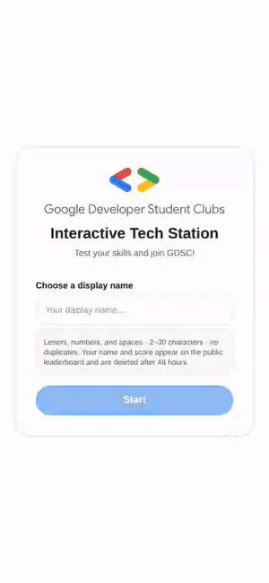
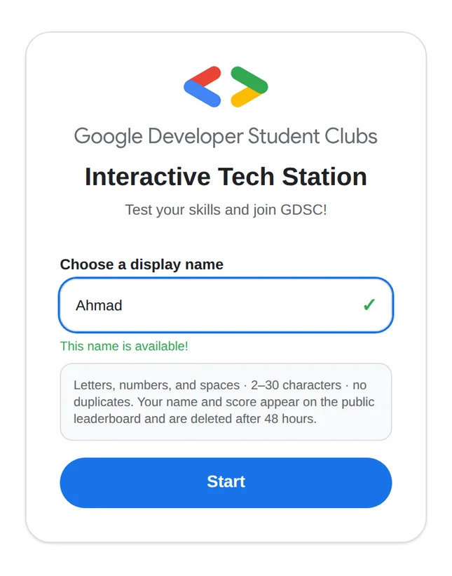
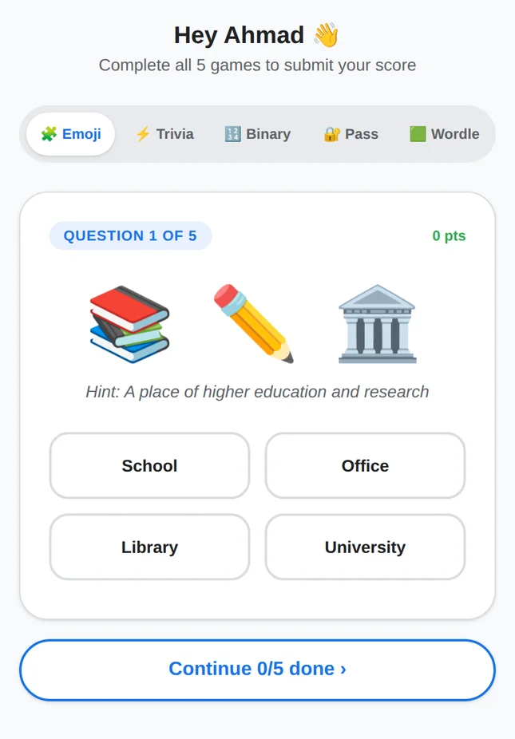
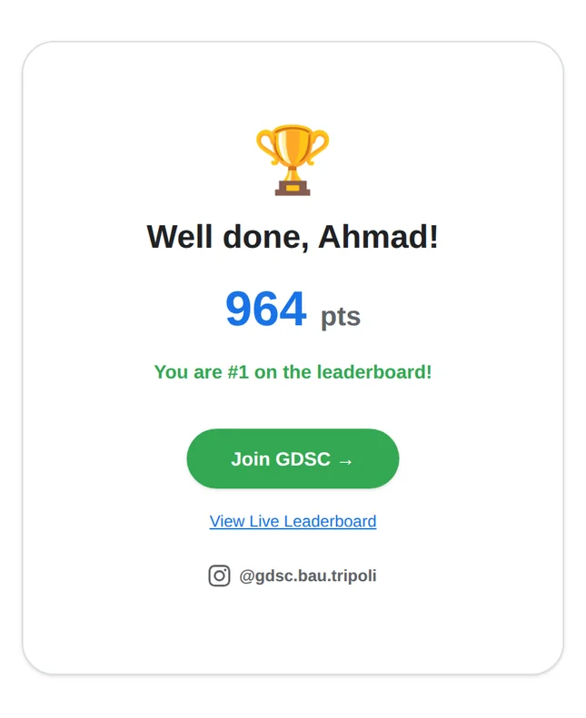
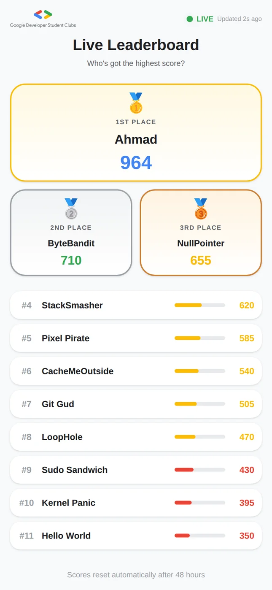
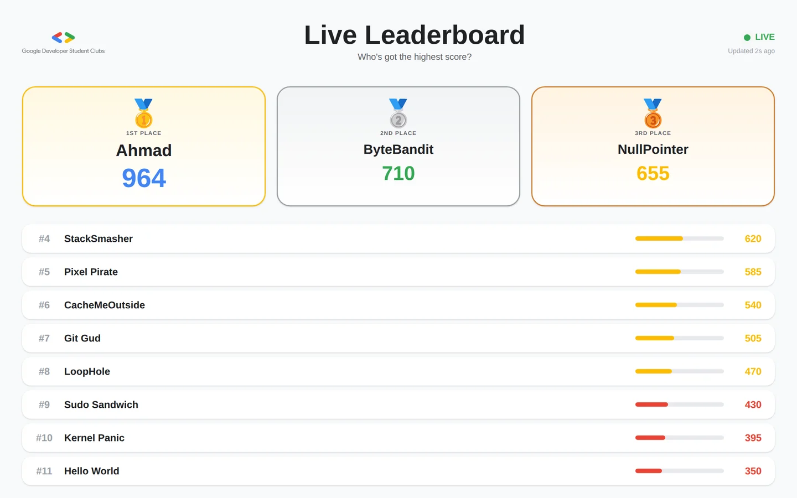

# BAU Open Doors 2026 · Faculty of Science: Tech and Science Challenge

The booth app for the **Beirut Arab University (BAU), Tripoli campus Open House**. Visitors choose a display name, enter a phone number, play three short tech and science mini-games, once each, in order, and land on a live leaderboard. The top 3 players of every hour win a prize, and a player qualifies by finishing all three games. The booth's second screen shows the leaderboard, the prize countdown and the hourly winners.

**50 students played the first version at the club fair.** It was designed, built and deployed in three days. It has since been reworked into a prize edition in which every game counts toward one leaderboard total.

> **Status:** the first version ran live at the club fair in September 2026 and is now offline. The Open House edition adds hourly prizes and the event clock. The screenshots and video below come from a local run of the first version, with sample names on the leaderboard. They predate the Open House edition, so the hourly prizes, the prize countdown, the hub, result screen and per-game scoring aren't pictured yet.

<p align="center">
  
</p>
<p align="center"><sub>Earlier version, sped up 2×. <a href="docs/screenshots/playthrough.mp4">Watch it at normal speed (MP4, 1:25)</a>.</sub></p>

## Screenshots

| Name entry | Emoji Riddles |
|---|---|
|  |  |

| Finish | Leaderboard (phone) |
|---|---|
|  |  |

**Booth second screen:**



## Open Doors 2026 edition (Faculty of Science)

- **Look.** The theme follows the Open Doors 2026 poster: BAU and Open Doors logos (`public/brand/`), the triangle mosaic (`components/Mosaic.tsx`), condensed Oswald headlines with Source Sans 3 text (self-hosted in `app/fonts/`, SIL Open Font License) and Faculty of Science yellow as the main colour. The colour tokens live in `app/globals.css` (`bg-sci`, `text-indigo`, …).
- **School, class and language.** Before starting, a player picks English or French, their school and their class: Grade 10, Grade 11 (Scientific or Literature) or Grade 12 (GS, SE or LS). The server checks them (`lib/profile.ts`) and stores them with the private contact, never on the leaderboard. Staff see the school and class next to each winner in the admin panel and in the CSV export.
- **School list.** Fill in `lib/schools.ts`, one school per line. Until it is filled in, players pick "My school is not in the list" and type the name.
- **French.** The questions themselves are unchanged. `lib/questions.fr.ts` holds the French text for every hint, question and option, keyed by the English text. A French player sees the French text, while the option sent to and graded by the server stays the English one. The interface strings are in `lib/i18n.ts`.
- **Booth loop** at `/marketing`: an animated how-to-play loop for the laptop or TV, with the QR code, the hourly prizes and a reminder to check the leaderboard. Tap once for music.
- **Winners ceremony** at `/announce`: reveals the day's top 9 (players who finished all three games) or one hour's top 3, with drumrolls, a name reel, a podium and fireworks. Space or click reveals the next winner, ← goes back, F is fullscreen, M mutes and Esc returns to the choices.

## How a visit works

1. **Name and phone.** Players choose a display name, which is reserved for 48 hours, and enter a phone number with its country code (Lebanon by default) so the booth can contact the prize winners. They must tick a consent box for the number. Pressing Start starts the event clock if this is the first player ever to start. Returning players on the same browser get their name and number back, but tick the box again.
2. **Play.** The three games start one after another, in a fixed order: Emoji Riddles, Memory Match, Tech Trivia. Each is played once.
3. **Result.** After each game the player sees the points they earned, their total and rank, and a button for the next game.
4. **Finish.** Finishing all three games qualifies the player for the prize of the hour in which they finished. After the last game the player sees their final total and rank, a link to the leaderboard and the sign-up form. Reloading the page picks up at the next unplayed game.

## Hourly prizes and the event clock

- **The clock starts with the first player.** The event clock starts when the first player ever presses Start on the home page. That moment is the start of hour 1. It is stored at `event/startedAt` in the database, set once and never moved.
- **Hours.** Hour N is the 60 minutes starting at start + (N-1) hours. The start is included and the end is not. Times are measured on the server clock.
- **Prizes.** In each hour the top 3 players by total score win a prize.
- **Eligibility.** Only players who have finished all three games are eligible. A player belongs to the hour in which they finished their third game.
- **Ranking and ties.** Within an hour, players are ranked by total score, highest first. A tie goes to whoever reached their total first, the same rule as the main leaderboard.
- **Still playing.** Players who have not finished all three games are shown on the main leaderboard, marked "Still playing". They are not in any hour's top 3.
- **Live and final.** The current hour is live. Completed hours are final.
- **Leaderboard screen.** The `/leaderboard` screen, on the booth's big screen and on phones, shows the BAU Tripoli Open House brand, a countdown "Hour N prize in MM:SS" to the end of the current hour (or "Prize clock starts with the first player" before anyone has started), this hour's top 3, and the earlier hours' winners. Each past hour shows its time window in local time and its three names with scores. Staff can see the winners there without opening the database.
- **Contacting winners.** Winners' names are on the leaderboard screen. Their phone numbers are read from the `contacts` node in the Firebase console, by name. Each record holds the name, the number and the time consent was given.
- **Expiry.** Entries expire 48 hours after they were made, as before, and the cleanup deletes them then. The winners shown for an hour come from those entries, so they expire too. The event clock is not affected.
- **The clock is never deleted.** `event/startedAt` holds only a timestamp and has no expiry. The daily cleanup never deletes it.

## The games

Every player plays **three games**, in order, **once each**. The server refuses to start a game that was already played or that is out of order. A game abandoned part-way (for example by closing the tab) can be started again, because it only counts once its score is recorded. Each game is graded on the server.

| Game | What you do | How it scores |
|---|---|---|
| Emoji Riddles | Work out the tech term or everyday word hidden in a row of emoji | Every correct answer scores. Faster finishes score more. |
| Memory Match | Flip cards and match 8 tech pairs | Fewer moves score more. Faster finishes score more. |
| Tech Trivia | Fast round of tech and general trivia | Right answers add, wrong ones cost you. Faster finishes score more. |

Each run gets a fresh random set of questions and a newly shuffled Memory Match layout, with answer options shuffled so the right answer isn't always in the same spot.

## Pausing the game

The admin panel at `/admin` pauses and resumes the game. While the game is paused, creating a session, starting a game and sending answers all answer 503, and the home page shows a paused notice with Start disabled. The leaderboard keeps working. `GAME_PAUSED` in `lib/config.ts` is only a fallback. It is used until the panel has ever set the pause flag.

## Admin panel

Staff sign in at `/admin/login` and then use the panel at `/admin`.

- **Password.** The password comes from the `ADMIN_PASSWORD` environment variable and must be at least 12 characters. Admin sign-in is refused while it is unset.
- **Lockout.** After 5 wrong passwords within 10 minutes, every sign-in is refused for 5 minutes. The lockout is global, not per visitor.
- **Sessions.** A signed-in session lasts 8 hours. Changing `ADMIN_PASSWORD` signs everyone out.

The panel can:

- start the event clock, or reset it, after the staff member types RESET to confirm;
- pause and resume the game;
- show each hour's winners with their phone numbers, and mark each prize as given;
- list the players, search them by name, edit their scores and delete them;
- download the winners as a CSV file;
- show the last 20 actions.

Phone numbers are shown only to signed-in staff. No public route returns them.

## Scoring and the leaderboard

- **Your total** is the sum of your score in each of the three games. There are no replays, so every player gets one attempt at each game.
- **Each game adds one score.** A player who has not finished all three has fewer scores adding up.
- **Ties** are rare, because every score includes a speed bonus: faster finishes score more. If two totals still match, whoever reached their total first ranks higher. The same rule applies inside an hour.
- The leaderboard shows every player, with small emoji chips for the games each player has a score in. Players who have not finished all three games are marked "Still playing" and are not in any hour's top 3.

## Keeping the leaderboard honest

A public leaderboard with hourly prizes is an open invitation to cheat, so the browser is never trusted with a score.

- **Answers stay on the server.** Correct answers and the Memory Match layout are never sent to the browser before the player has acted. Answers to Emoji Riddles and Tech Trivia never reach the browser before the player submits them, and the browser learns which were right only from the server's reply to that submission.
- **Graded on the server.** Emoji Riddles and Tech Trivia are graded in one batch when the round ends: the browser sends all of its answers together, and the server grades them then. Memory Match is graded step by step, one card flip at a time. The server keeps each run's state in one transaction, so double taps can't count twice.
- **Instant feedback, still graded on the server.** In Emoji Riddles and Tech Trivia, each pick is sent to the server as it is made. The server locks in the first answer for that question and replies right or wrong, so the screen can flash green or red at once. Only the question just answered is revealed, a repeat can't change the answer, and questions must be answered in order. The final batch still decides the score and the review.
- **The server measures time.** Each run's duration is taken from the server's clock, not the browser's.
- **One run at a time.** A run can be finished only once. Memory Match takes its flips one at a time, in order, with no retries. Each game can be played once and only in order, which the server checks against the leaderboard. Starting a new run of a game ends any earlier run of that game that is still open.
- **Sessions expire.** Session tokens are encrypted, carry only the name and an issue time, and last 90 minutes.
- **Unique names.** A display name is reserved for 48 hours, so nobody can pose as another player.
- **Locked-down headers.** A Content-Security-Policy limits scripts and connections to the app and Firebase.

**Known limit:** the game endpoints are public HTTP routes, so a determined player can script their way through the games without the browser. The end-of-game review also shows the correct answers, so a script that plays many rounds could collect the question pool and later replay known answers. Server grading and timing make this harder, not impossible. For that reason each prize winner should be confirmed in person before the prize is handed over.

## Privacy

- Players give a display name and a phone number. The display name is public: it appears on the leaderboard.
- The phone number is stored privately, only so the booth can contact the prize winner. It is never shown on the leaderboard and never returned by any API route. The leaderboard API returns only names, scores and game data. Players must tick a consent box before they can start.
- The winner's number is read from the `contacts` node in the Firebase console. Each record holds the name, the number and the time consent was given.
- A phone number is reserved for 48 hours, like a display name, so one number belongs to one player at a time. A country code is required (Lebanon by default), so one number is unique however it is typed: with `+` or `00`, and with or without the trunk `0`.
- The browser remembers the last country and phone number so returning players don't retype it. Consent is never remembered, so it is asked again on every visit.
- Every record is written with an `expiresAt` timestamp 48 hours out. A daily Vercel cron job (`/api/cron/cleanup`, protected by `CRON_SECRET`) deletes anything past it, including phone numbers and contacts, along with expired game runs.
- The event clock (`event/startedAt`) holds only a timestamp. It has no expiry and the daily cleanup never deletes it.
- No IP addresses or other identifiers are stored.

## Stack

Next.js 16 (App Router) · React 19 · TypeScript · Tailwind CSS 4 · Firebase Realtime Database (Admin SDK on the server) · Vercel (hosting and cron) · Jest and React Testing Library

### API routes

| Route | Purpose |
|---|---|
| `POST /api/session` | Checks and reserves a display name and a phone number, issues a session token (no game content), and starts the event clock with the first player |
| `GET /api/names/check` | Whether a display name is free, or already held by this browser |
| `POST /api/game/start` | Starts a fresh run of one game and returns its questions or board, with no answers |
| `POST /api/game/action` | Submits one action for a run (one checked answer, a batch of answers or a card flip) and returns the graded result |
| `POST /api/me` | The player's name, total, rank and score in each game |
| `GET /api/leaderboard` | Live leaderboard entries, the event clock, and each hour's top 3 (no phone numbers) |
| `GET /api/cron/cleanup` | Daily cleanup of expired names, phone numbers, contacts, leaderboard entries and game runs |
| `GET /api/status` | Whether the game is paused, with the notice text |
| `/api/admin/*` | Admin panel API: sign-in, event clock, pause, winners, prizes, players and CSV export. Every route except sign-in needs the admin cookie. |

### Project structure

```
app/
  page.tsx               name and phone entry and consent
  play/page.tsx          game flow: hub, loading, game, result
  leaderboard/page.tsx   live leaderboard with the prize countdown and hourly winners
  admin/                 staff panel and sign-in (/admin, /admin/login)
  api/session            issues session tokens
  api/game/start         starts a run
  api/game/action        grades one action and finishes runs
  api/me                 the player's scores
  api/leaderboard        leaderboard and event clock via the Admin SDK
  api/names/check        display-name availability
  api/cron/cleanup       deletes expired records
  api/admin              admin panel API, cookie-protected
components/games/        the three mini-games
components/              game hub, result screen, leaderboard table
components/RoundBoard.tsx    the hourly winners
components/BrandMark.tsx     the Open House brand mark
lib/                     shared API types, client API wrappers, session helpers,
                         server scoring, game metadata, question pools, Firebase
lib/event.ts             event clock and hourly rounds
__tests__/               unit, component, page and API route tests
```

## Running locally

```bash
npm install
cp .env.example .env.local   # then fill in the values below
npm run dev
```

| Variable | Purpose |
|---|---|
| `SESSION_SECRET` | Key material for the encrypted session tokens |
| `FIREBASE_PROJECT_ID`, `FIREBASE_CLIENT_EMAIL`, `FIREBASE_PRIVATE_KEY` | Firebase Admin SDK service account |
| `NEXT_PUBLIC_FIREBASE_API_KEY`, `NEXT_PUBLIC_FIREBASE_AUTH_DOMAIN`, `NEXT_PUBLIC_FIREBASE_DATABASE_URL`, `NEXT_PUBLIC_FIREBASE_PROJECT_ID` | Firebase client config |
| `CRON_SECRET` | Bearer token Vercel sends to the cleanup cron |
| `ADMIN_PASSWORD` | Password for the admin panel at /admin (at least 12 characters) |

```bash
npm test        # Jest
npm run lint
npm run build
```


## Author

Built by [Ahmad Nasser](https://ahmadnasserx.com), Tech Lead, GDG on Campus BAU Tripoli.
