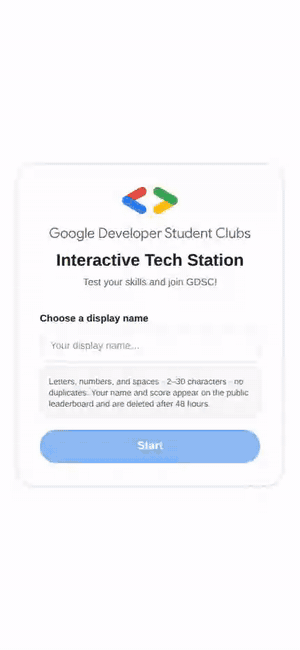
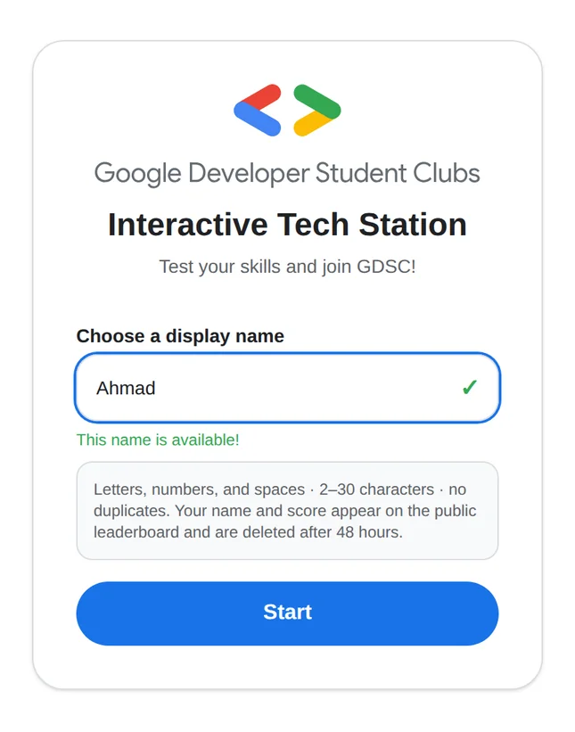
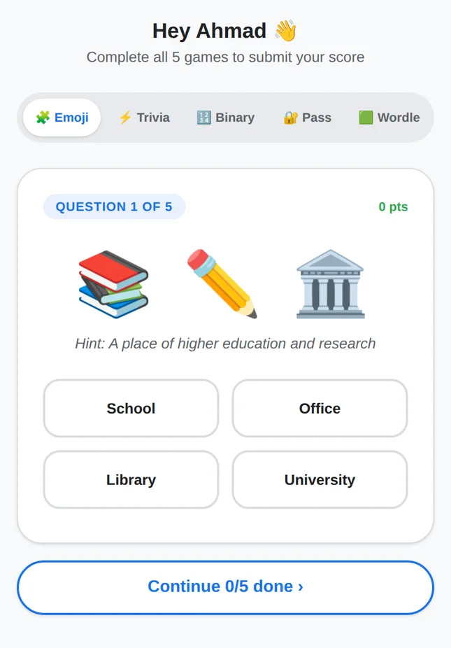
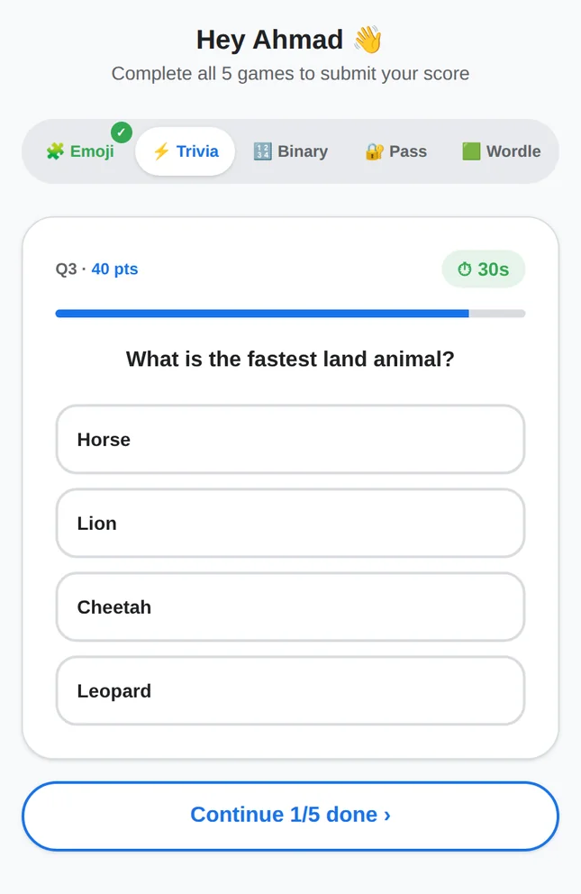
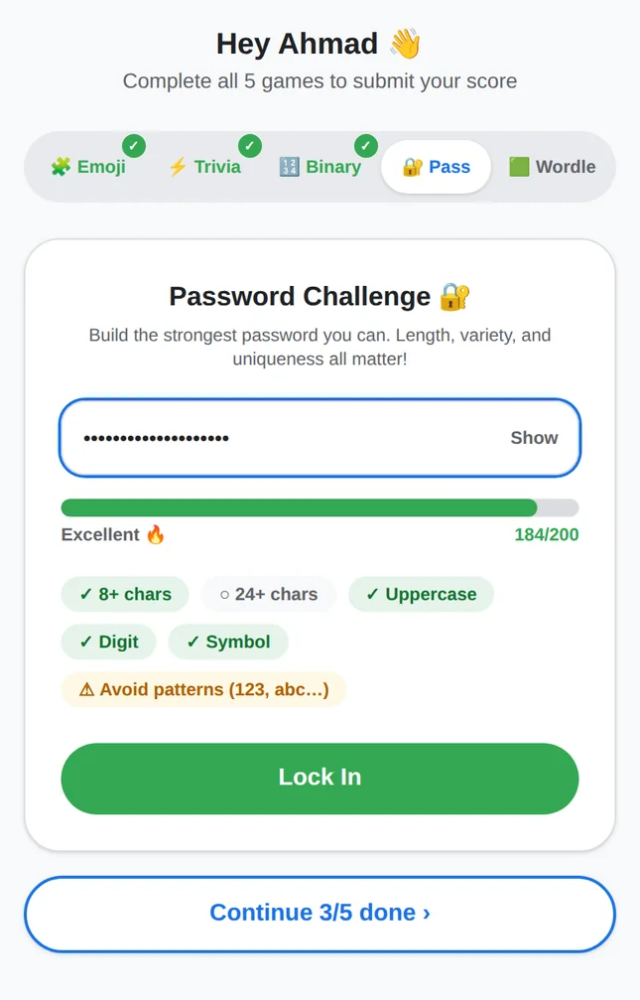
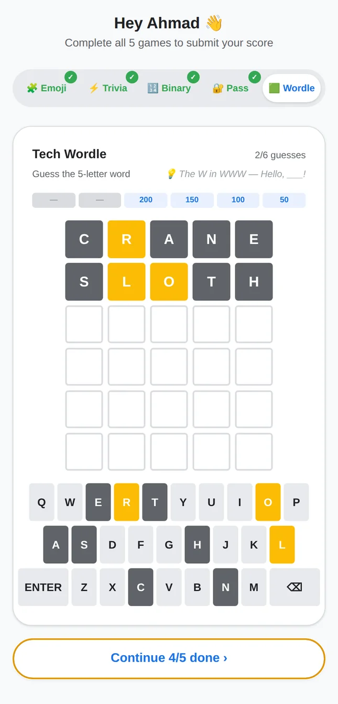
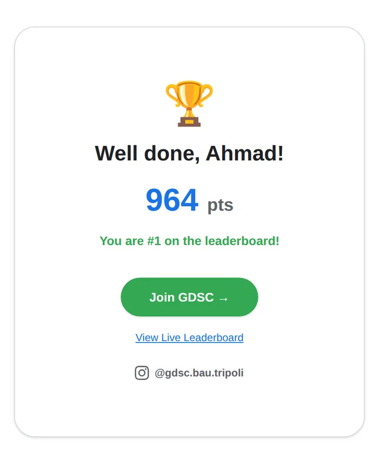
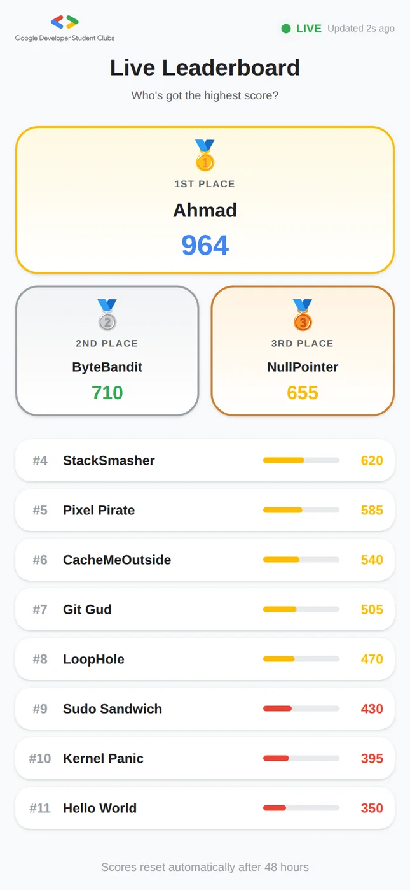
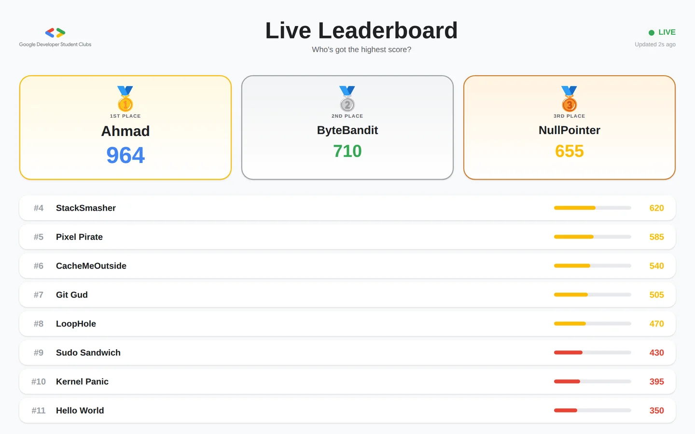

# GDSC Booth: Interactive Tech Station

The booth app for **Google Developer Groups on Campus, Beirut Arab University, Tripoli Campus**. Students walk up to a device, enter a display name, play six short tech mini-games, and land on a live leaderboard. The player at the top of the leaderboard at the end of the day wins a prize. A second screen at the booth shows the leaderboard updating in real time, and the finish screen links to the chapter sign-up form.

**50 students played the first version at the club fair.** It was designed, built and deployed in three days. It has since been reworked into a prize edition in which every game counts toward one leaderboard total.

> **Status:** the first version ran live at the club fair in September 2026 and is now offline. The screenshots and video below come from a local run of that version, with sample names on the leaderboard. They predate the prize edition, so the hub, result screen and per-game scoring aren't pictured yet.

<p align="center">
  
</p>
<p align="center"><sub>Earlier version, sped up 2×. <a href="docs/screenshots/playthrough.mp4">Watch it at normal speed (MP4, 1:25)</a>.</sub></p>

## Screenshots

| Name entry | Emoji Riddles | Tech Trivia |
|---|---|---|
|  |  |  |

| Password Challenge | Wordle |
|---|---|
|  |  |

| Finish | Leaderboard (phone) |
|---|---|
|  |  |

**Booth second screen:**



## How a visit works

1. **Name.** Players choose a display name. It is reserved for 48 hours, and returning players on the same browser get their name back.
2. **Hub.** The games screen shows all six games, the player's best in each one, their total, and their rank.
3. **Play.** Any game can be started, and any game can be replayed as many times as the player likes.
4. **Result.** After each run the player sees the points they earned, whether it was a new best, their total and rank, and buttons to play again, move to the next game they haven't played, or return to the hub.

## The games

Every player plays **all six games**, in any order, and as often as they like. Each game is graded on the server.

| Game | What you do | How it scores |
|---|---|---|
| Emoji Riddles | Work out the tech term or everyday word hidden in a row of emoji | Every correct answer scores. Faster finishes score more. |
| Tech Trivia | Fast round of tech and general trivia | Right answers add, wrong ones cost you. Faster finishes score more. |
| Password Challenge | Build the strongest password you can | Length, character variety and no predictable patterns score higher |
| Tech Wordle | Guess a five-letter tech word in six tries, with a hint after two guesses | Fewer guesses score more. Faster finishes score more. |
| Memory Match | Flip cards and match 8 tech pairs | Fewer moves score more. Faster finishes score more. |
| Bug Hunter | Spot the bug in short Java snippets | Every bug you catch scores. Faster finishes score more. |

**Tech Wordle** has an on-screen keyboard that spans the full card width with large touch targets, a staggered tile-flip reveal and keyboard colours that only update once the row has flipped. Physical keyboards work too.

Each run gets a fresh random set of questions, a new Wordle word and a newly shuffled Memory Match layout, with answer options shuffled so the right answer isn't always in the same spot.

## Scoring and the leaderboard

- **Your total** is the sum of your best score in each of the six games. Replaying a game can only raise its best; a weaker run never lowers it.
- **Each game adds one score.** A player who has played fewer games has fewer bests adding up, so playing all six is usually what puts someone on top.
- **Ties** are rare, because every score includes a speed bonus: faster finishes score more. If two totals still match, whoever reached their total first ranks higher.
- The leaderboard shows the top 20 players, with small emoji chips for the games each player has a score in.

## Keeping the leaderboard honest

A public leaderboard with a prize at the end of the day is an open invitation to cheat, so the browser is never trusted with a score.

- **Answers stay on the server.** Correct answers, the Wordle word and the Memory Match layout are never sent to the browser before the player has acted. Answers to Emoji Riddles, Tech Trivia and Bug Hunter never reach the browser before the player submits them, and the browser learns which were right only from the server's reply to that submission.
- **Graded on the server.** Emoji Riddles, Tech Trivia and Bug Hunter are graded in one batch when the round ends: the browser sends all of its answers together, and the server grades them then. Wordle and Memory Match are graded step by step, one guess or card flip at a time. The server keeps each run's state in one transaction, so double taps can't count twice.
- **The server measures time.** Each run's duration is taken from the server's clock, not the browser's.
- **One run at a time.** A run can be finished only once. Wordle and Memory Match take their moves one at a time, in order, with no retries. Starting a new run of a game ends any earlier run of that game that is still open.
- **Sessions expire.** Session tokens are encrypted, carry only the name and an issue time, and last 90 minutes.
- **Unique names.** A display name is reserved for 48 hours, so nobody can pose as another player.
- **Locked-down headers.** A Content-Security-Policy limits scripts and connections to the app and Firebase.

**Known limit:** the game endpoints are public HTTP routes, so a determined player can script their way through the games without the browser. The end-of-game review also shows the correct answers, so a script that plays many rounds could collect the question pool and later replay known answers. Server grading and timing make this harder, not impossible. For that reason the prize winner should be confirmed in person before the prize is handed over.

## Privacy

- Players give only a display name, and a consent notice on the entry screen says it will appear publicly.
- Every record is written with an `expiresAt` timestamp 48 hours out. A daily Vercel cron job (`/api/cron/cleanup`, protected by `CRON_SECRET`) deletes anything past it, along with expired game runs.
- No IP addresses or other identifiers are stored.

## Stack

Next.js 16 (App Router) · React 19 · TypeScript · Tailwind CSS 4 · Firebase Realtime Database (Admin SDK on the server) · Vercel (hosting and cron) · Jest and React Testing Library

### API routes

| Route | Purpose |
|---|---|
| `POST /api/session` | Checks and reserves a display name, and issues a session token (no game content) |
| `GET /api/names/check` | Whether a display name is free, or already held by this browser |
| `POST /api/game/start` | Starts a fresh run of one game and returns its questions or board, with no answers |
| `POST /api/game/action` | Submits one action for a run (an answer, a guess, a card flip, or a password) and returns the graded result |
| `POST /api/me` | The player's name, total, rank and best in each game |
| `GET /api/leaderboard` | Leaderboard entries |
| `GET /api/cron/cleanup` | Daily cleanup of expired names, leaderboard entries and game runs |

### Project structure

```
app/
  page.tsx               name entry, consent and the end-of-day prize notice
  play/page.tsx          game flow: hub, loading, game, result
  leaderboard/page.tsx   live leaderboard for the booth screen
  api/session            issues session tokens
  api/game/start         starts a run
  api/game/action        grades one action and finishes runs
  api/me                 the player's scores
  api/leaderboard        leaderboard read via the Admin SDK
  api/names/check        display-name availability
  api/cron/cleanup       deletes expired records
components/games/        the six mini-games
components/              game hub, result screen, leaderboard table
lib/                     shared API types, client API wrappers, session helpers,
                         server scoring, game metadata, question pools, Firebase
__tests__/               unit, component, page and API route tests
```

## Running locally

```bash
npm install
cp .env.example .env.local   # then fill in the values below
npm run dev
```

| Variable | Purpose |
|---|---|
| `SESSION_SECRET` | Key material for the encrypted session tokens |
| `FIREBASE_PROJECT_ID`, `FIREBASE_CLIENT_EMAIL`, `FIREBASE_PRIVATE_KEY` | Firebase Admin SDK service account |
| `NEXT_PUBLIC_FIREBASE_API_KEY`, `NEXT_PUBLIC_FIREBASE_AUTH_DOMAIN`, `NEXT_PUBLIC_FIREBASE_DATABASE_URL`, `NEXT_PUBLIC_FIREBASE_PROJECT_ID` | Firebase client config |
| `CRON_SECRET` | Bearer token Vercel sends to the cleanup cron |

```bash
npm test        # Jest
npm run lint
npm run build
```


## Author

Built by [Ahmad Nasser](https://ahmadnasserx.com), Tech Lead, GDG on Campus BAU Tripoli.
